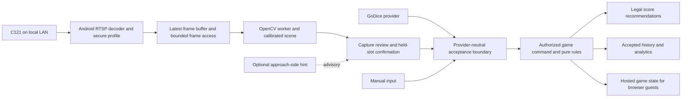

# SW-006: Android C121 game design and POC sprints

1 October 2026. Engineer/coordinator: Codex. Product owner owns acceptance. Independent reviewer: unassigned.
State: proposed software design and sprint plan; platform sequence accepted; implementation/native protocol/physical acceptance open.
Task control: [SW-006](plans/SW-006-c121-local-camera.md). Inputs: [hardware handover](c121-software-handover.md), [platform decision](decisions/2026-10-01-camera-platform-sequence.md), current source and three parallel read-only agent reviews. User selected approach-side player hints first on 1 October; no face recognition in this POC.

Implementation checkpoint: the first local slice is now implemented, with automated/compiled evidence in [SW-006 first-slice results](plans/SW-006-first-slice-results.md). Actual RTSP pixels, C121/phone recognition and physical POC acceptance remain open. The remaining design/sprint targets below are proposals.

## Product outcome

Keep the existing Android Capacitor game and shared pure rules. Add a C121 input alongside manual scoring and the separately provisioned GoDice evaluation. One Android host owns one local camera; everyone uses the existing game/scorecard. Camera video stays on the LAN and host. Browser guests receive accepted game state and recommendations, not video. Hosted multiplayer continues requiring internet; standalone local play and camera processing should work without internet after vendor camera setup and packaged runtime preparation. The existing Pi authority remains separate.

Connection -> live preview -> confirm actual tray outline -> start the authoritative turn -> roll -> Capture -> review five faces and held slots -> Confirm roll -> legal score recommendations -> player chooses/confirms category -> persist accepted events and corrections. Capture and score confirmation are separate. First POC uses player-triggered capture; recognition and score recommendations are generated automatically, but observation never automatically consumes a roll or scores a category. Continuous settled-scene proposals can follow after fresh motion/latency evidence. Equal face values do not establish whether a new roll occurred.

The connection screen provides manual IP/host, camera account credentials, stream selection, preview, status, disconnect, replace credentials and remove profile. Native code owns secret persistence. During a turn show active player, roll allowance, camera health, five provisional/reviewed faces, kept dice and legal category scores. Incomplete/ambiguous scenes have visible warnings and correction controls. Connection loss offers reconnect and manual completion without discarding the game. Restored connection requires a new capture. Tablet layouts place scorecard and capture alongside each other; phone layouts retain a compact capture panel and accessible shared scorecard. Use the existing 44px control and width/orientation/accessibility requirements.

## Existing implementation and evidence

| Area | Reuse | Remaining work / evidence limit |
|---|---|---|
| Android | Capacitor 8.5.2, API 24 minimum / target 36, native BLE and MainActivity inset handling | No RTSP plugin, decoded frame bridge or secure camera credential implementation; Gradle/APK and phone decoder evidence required |
| Recognition | OpenCV pip reader, rotated face rectification, threshold agreement, legal pip layout and conservative contact splitting in src/dice/camera/recognizer.js | Ordinary light pipped D6s on confirmed tray only initially; C121 focus, compression, perspective, touching dice and lighting unqualified |
| Camera lab | src/dice/camera-lab.js, camera/worker.js, tracking.js, setup.js, feedback.js and tray monitor | Current video/canvas acquisition is webcam/replay, lab confirmation is not production game acceptance; extract components rather than mount the whole lab into the game |
| Capture | input/coordinator.js has sources, context, sequence, candidate/acceptance and logical holds | Lab-only in-memory records; hard-coded 2s wall-clock freshness; needs native timing and review-lifecycle redesign |
| Game | src/game/core.js scoreOptions, mode rules, corrections, command IDs and rollAnalytics | Core excludes camera source; add explicit provider evidence validation without weakening BLE checks |
| Multiplayer | src/multiplayer/room.js membership, seat/revision and actor/idempotency checks; browser shared scorecard | Only manual/GoDice room inputs; host capture delegation is GoDice-specific; camera requires explicit authority contract and bounded proposal payloads |
| Persistence | src/core-store.js journal/IndexedDB recovery, versioned game events | Camera observations, corrections, source versions and bounded diagnostics need durable schema/migration; raw media does not belong in game JSON |
| GoDice | Existing BLE capture/automatic-capture and private evaluation panel; standard native generic connection panel | Private evaluation stays separate with marker. Physical five-dice/two-phone qualification remains SW-003; no camera imitation of BLE packets/IDs |

Research evidence must be read in sequence, not as one accuracy claim:

- 28 September untouched webcam checkpoint: 6/10 exact rolls, 46/50 correct dice, four rejected, zero accepted incorrect readings in that collection. Later reuse for tuning removes its independence for later versions.
- Recognition v0.4 development replay: 29/31 exact rolls, 153/155 readable dice. Development data, not independent acceptance.
- Later fourth batch checkpoint: 7/10 complete, 47/50 readable before subsequent tuning.
- v7.3 / current v0.5 development replay: 46/51 exact saved frames; 49 camera tests reported in the recognition document. Still-image replay does not qualify live hold tracking, player hints or C121.
- Hand hints were present in six fresh-session frames, four suggesting Player 2, but no confirmed player ground truth: no measured player accuracy.
- SW-001 current-session automated evidence: 299 workstation tests with camera/private inputs; supported source copy 269 passed and 13 optional-camera skips; web/native/room builds passed. Source digest and dependency hashes are in its task record. Dependencies were reused; fresh install and remote CI remain open. These counts predate this documentation and are not a new C121 run.

Research already chose OpenCV pip geometry before a trained model, MediaPipe hand landmarks for approach hints, confirmed polygon calibration and conservative uncertainty. setup-camera-assets.mjs declares OpenCV 4.13.0, MediaPipe 0.10.21 and hand model version 1, with generated checksums/licence manifest. Verify and package those inputs for an offline-capable Android camera build; optional-camera-free CI remains useful but cannot qualify recognition. Any learned detector is a later evidence-driven decision, not a required rewrite.

## Architecture and ownership

Native module proposal: connect(profileId), disconnect(), getStatus(), acquireLatestFrame(request), retain/releaseFrame(frameId), credential replacement/removal and transport-state events. No secret-bearing URI is returned to JavaScript. Frame envelope: schema version, camera/profile ID, source provenance, session generation, frame sequence/token, native monotonic receive/decode timestamps, dimensions, orientation, crop/resize transform, calibration/configuration ID and decoder/recognizer versions. Capture timestamps from the sensor may be unknown; label arrival/decode times honestly. Explicitly document native-to-JS time mapping; never subtract unrelated clocks or use Date.now to imply sensor freshness.

Use native preview, one latest decoded frame and at most one inference job. A pinned review frame is retained separately and released on completion/cancel; define memory/byte limits, frame ownership and token expiry. New frames supersede pending work. Start with demand-driven app-private frame access through the WebView's existing local origin or a measured binary bridge, converted into ImageBitmap/RGBA and transferred to the worker. Preview-rate full-frame base64 JSON is excluded. A private resource route must enforce origin/token/size/lifetime, deny arbitrary paths and not create a LAN video server. The native spike must prove the specific decoder-to-pixels mechanism; a working player surface is insufficient. Compare lossless/RGBA transfer against bounded compressed snapshots for pip fidelity and latency before choosing. Preserve a full-detail pinned review/calibration image; inference uses a measured tray crop/resolution, with coordinates mapped back exactly.

Media3 is the first RTSP candidate, conditional on decoded pixel access, current Android compatibility and C121 codec. Its official documentation lists H264, BASIC/DIGEST and forced RTP/TCP; it does not prove this specimen or a turnkey pixel bridge. Begin fixture comparison using TCP, measure latency versus UDP rather than promising one is fastest. Freeze one tested dependency version after the spike. If Media3 frame extraction or codec compatibility fails, record measured alternatives and licence/build impact before adopting another native decoder. No custom RTSP stack is planned.

Secure credentials: Android Keystore protects an encryption key; encrypted credentials remain in app-private storage with backup exclusions. A native credential-entry sheet can keep password entry outside JS entirely. Secret URLs may be constructed internally for RTSP authentication but must be sanitized in errors, logs, telemetry and exports. Remove both ciphertext and unused key on profile removal. App manifest currently allows backup; add narrowly scoped exclusion rules. Camera network traffic is local, with no public port forwarding. Include merged-manifest/network access review for target Android versions in the native gate.

Connection state: disconnected, connecting, live, interrupted, authentication-failed, unsupported-stream. Lifecycle/background, Wi-Fi change, decode stalls and reconnect trigger bounded retries and a new generation. Loss, new generation, calibration/geometry change, source switch and turn/revision change invalidate in-flight results and pending captures. Explicit disconnect releases player/socket/surface/buffers and retry jobs.

### Freshness and review are different

The current coordinator's 2s expiration will make a normal human correction review expire. Validate frame age and buffer lag when freezing; retain the immutable observation for review while checking authoritative context, session continuity and subsequent scene motion. Require a new capture after invalidation. Never keep an old scene eligible merely by refreshing its timestamp. Review timeout and whether visible new motion invalidates a review are explicit tested policies, not silently changed thresholds. Frozen review UI may remain visible for explanation after invalidation, with confirmation disabled. Network arrival age cannot detect vendor buffering by itself: use fixture visual timestamps and physical visible motion references to measure scene-to-review delay.

### Rules, authority and persistence

Add camera as a versioned source with whole-scene evidence. Do not manufacture persistent per-die IDs: camera dice use logical slots and a confirmed held mask, with ambiguity surfaced. Preserve unknown holds in diagnostics; game rerolls require resolved holds. Keep BLE physical device ID/epoch requirements intact. Provider capabilities can control UI, but validation still uses explicit allowed evidence schemas. Source changes cancel pending capture; switching to manual fallback records missing observation coverage.

For local play, command acceptance and durable save determine success. For hosted play, the host produces/reviews camera proposals; active player's authenticated command confirms the roll/score against current seat, turn and revision. A bounded host proposal record/ID allows server validation, consume-once and rejection of non-host proposals or wrong-player confirmations. It is new code, not a current capability. Keep host transport ownership distinct from active-player authority and do not automatically copy GoDice's delegated turn-start behaviour into camera rooms. Guests receive five values/status and proposal metadata, not raw images. Retry uses the same command ID; conflicts refresh and require revalidation. Scoring remains a separate active-player action.

Accepted history schema: roll/previous-roll IDs, game/turn/player IDs, roll number, source/media origin, before/after values, held mask/identity scope, original prediction, confirmed values, correction events and reason, capture/session/frame IDs, calibration/recognizer/settings identity, time semantics/stage timings, accepted command ID and optional evidence reference. Preserve source identity after a manual correction instead of replacing it with only a manual-correction label. Save accepted data durably in local journal/IndexedDB or canonical hosted events, with migration and bounded sizes. Transport diagnostics use bounded separate retention; no raw preview frames in permanent game state.

Analytics: recorded and corrected rolls, natural combinations and distinct turns, final category/outcome, holds/rerolls only where resolved, modes/rules versions and source coverage. Incomplete/manual-only turns are unknown roll coverage, not zero combinations. Add recognition rejection/correction and pipeline latency views for POC diagnostics. Do not claim physical per-die bias for visually identical dice. Optional image/clip capture is explicit opt-in, app-private, deletable and exported only deliberately; defaults retain structured roll history, not continuous video or biometric data.

### Fast recommendations and optional player hints

Compute scoreOptions locally from reviewed/accepted faces using existing pure rules; no cloud inference or AI call is needed. Provisional preview scores may be labelled clearly, but score submission uses accepted state. Benchmark stream buffering, decode, frame transfer, inference, settling and UI presentation separately. Existing stability gate requires four consistent frames and 650ms; do not reduce it blindly for speed. Camera stream2 may trade detail for speed: choose from measurements, not megapixel marketing. Keep hands/tray monitoring at lower independent frequency and suspend optional work under load.

Approach-side hints are optional/off by default. Calibrate seat zones on the wider image, map them to game participants, and retain hinted seat, uncertainty and user-confirmed roller separately. Crossed/multiple hands, retrieval and occlusion must produce unclear/ambiguous results. The accepted seat still comes from the game. Hint failure must not block the core capture path; unresolved hand occlusion still prevents claiming a clear settled scene. This is spatial approach estimation, not face/biometric recognition.

## Sprint plan and multiple-agent execution

Sprints below are ordered deliverable units, not a promise of calendar duration. Plan short checkpoints; estimate effort after the native pixel-access spike. Camera arrival does not remove decoder/baseline dependencies. Each sprint ends with an integrated demonstration, focused regression evidence and explicit untested rows. No automatic purchase, publish or device deployment is included.

| Sprint | Deliverable | Parallel ownership after baseline isolation | Exit evidence |
|---|---|---|---|
| 0: reproducible contract baseline | Preserve/freeze scoped supported source including newer untracked work; resolve fresh npm/Node24 and Android toolchain; observation/source/authority schema, migrations and test fixtures | Coordinator owns baseline, interfaces and integration; other agents read-only until ownership frozen | Source/dependency manifest, private exclusions, reproducible installs/build gate; agreed contracts and test matrix; remote CI state reported |
| 1: native vertical slice | Authenticated RTSP fixture -> actual decoded pixels -> worker -> overlay/review; secure profile, explicit states, bounded frames and lifecycle | Native agent owns Android plugin/Gradle/manifest; vision agent owns transport adapter and frame contract tests; game agent prepares source schema against mocks | Actual APK and fixture decoding, auth failure and reconnect/background tests; memory/transfer timings; exact chosen decoder dependency; mocks separately labelled |
| 2: C121 local game slice | Preview/calibrate actual stream; capture/correct/held slots -> accepted roll -> legal recommendations; source switch/manual fallback and recovery | Vision agent owns recognizer/worker/calibration; game agent owns core/coordinator/prototype integration; native agent closes lifecycle/security defects | Local complete simulated/replay games in all modes, reload/save failure, fresh/stale/session/calibration/limit tests; camera fixture end-to-end review; no fake BLE IDs |
| 3: durable evidence and analytics | Versioned observations/corrections, timing metrics, bounded media/diagnostics, useful game history | Game agent owns core-store/event/analytics integration; vision agent supplies quality/provenance; native agent redaction/export limits | Duplicate/exclusion/correction/migration tests; restart preserves accepted history; unknown coverage visible; credentials absent from exports |
| 4: hosted camera games | Camera room mode, host proposal production, active-player confirmation, shared recommendations and browser scorecards | Game agent owns room/server/UI as one boundary; native/vision agents support faults; coordinator reviews authority and migration | Nonmember/nonhost/wrong-seat/stale/duplicate rejection; retry and browser reconnect; mixed manual fallback; representative 1/2/3/8-player software journeys; live backend gate separate |
| 5: optional hints and speed refinement | Approach-side hints, measured scheduling/resolution and stable-scene UX refinements; preserve GoDice compatibility | Vision agent owns hand/seat hints; native agent owns timing/backpressure; game agent checks both providers and analytics | Ground-truth hint sequences and ambiguous cases; hints off/load failure don't block game; p95 latency/memory measurements; GoDice regressions and private distribution guard retained |
| 6: identified C121 POC qualification | Actual C121/phone/APK, fresh optics/lighting dataset, offline LAN and adverse/recovery/full-game acceptance | Coordinator integrates evidence; physical HW/INT session remains separate and explicitly identified | Accepted thresholds/test counts, exact revisions, fresh held-out recognition results, full games and recovery matrix; product-owner G3 decision; remaining limitations stated |

Read-only design reviews used three agents this turn (Android, vision/evidence, game/authority). Implementation uses coordinator plus three agents, maximum four active: native transport/security; vision/calibration; game/UI/authority/data. Each uses a scoped worktree/branch based on the same reconciled baseline, with named file ownership. Avoid creating worktrees from current HEAD alone: newer source is untracked. Coordinator integrates one contract-compatible slice at a time and owns shared package/config/status changes; no two agents edit the same file concurrently. Agent reviews support engineering evidence but do not substitute for an independent reviewer. Hardware design/specimen changes return through HW/INT control; no cross-chat messages are assumed authorized.

Optional hints must not delay a camera core POC. Future real GoDice testing is SW-003, after the camera vertical slice: five-dice pairing, held rerolls, duplicates, late epochs, disconnect/background/retry and two-phone complete games. Camera and GoDice are selectable providers; one provider owns a turn, and switching cancels stale candidates. Do not merge simultaneous providers. Independent GoDice qualification is not a prerequisite to C121 recognition qualification, but existing behavior/distribution tests must remain green.

## Proposed POC measurement targets and gates

These numerical targets are planning proposals, not accepted requirements or current results. Sprint 1 supplies first phone/fixture timings; refine before physical acceptance, record product-owner agreement in SW-006/INT-002.

| Metric | Proposed starting target / method |
|---|---|
| Camera response | Median <=750ms and p95 <=1500ms from visibly settled scene to review/recommendation readiness; max and each pipeline stage also reported. Includes settling; excludes human correction/confirmation. Use timestamped fixture and physical motion reference, not arrival time alone. |
| Fresh recognition coverage | >=95/100 complete exact five-dice rolls without correction in the declared normal-use envelope; all 100 saved/labelled including failures. Separate adverse-condition set; report per-die correct/wrong/rejected counts and uncertainty, not only multiset matching. |
| Safety of acceptance | No unconfirmed camera roll/score, stale/session-invalid accepted command, duplicate accepted roll or silent wrong value in the collected test set. Zero observed errors does not establish a population guarantee. |
| Sustained operation | At least 60 minutes and three complete two-player games at frozen configuration; report heat, memory growth, lag, corrections, disconnects and missing history. Add solo/eight-player and all-mode automated journeys; targeted physical mode checks. |
| Recovery | At least five cycles each of camera reboot, LAN interruption, host background/resume and guest reconnect; app restart/history recovery and failed/retried command tests; old pending scene cannot commit afterward. |
| Player hints | Optional diagnostic: report correct/incorrect/unclear hints from at least 40 labelled approach episodes balanced across two seats, with crossed/simultaneous hands separately. No POC authority dependency or accuracy claim from current unlabelled data. |

Hardware matrix: elevated side/downward views, measured near/far die pixels and focus, ambient/one/two diffused lamps, geometry/lux where measured, glare/banding, edge/touching/stacked/cocked/hand-occluded scenes. Only declared normal envelope feeds headline coverage. Keep failure and adverse scenes. Tuning set and untouched acceptance set are separate; tuning reopens the affected acceptance rows. Stream codec/dimensions/rate, C121 hardware/firmware, phone/OS/WebView, APK/source/dependency hashes, calibration and network/light geometry accompany every acceptance run. No camera received/connected or physical session is claimed by this plan.

Existing regression map: tests/core.test.js, core-store.test.js, game-capture.test.js, rooms.test.js, host-dice-room.test.js, hardware-turn.dom.test.js, shared-hardware.dom.test.js, camera-recognizer.test.js, camera-tracking.test.js, camera-tray-tracker.test.js, camera-setup.test.js, camera-feedback.test.js and camera-lab.dom.test.js. Extend observable authority/recovery behaviour rather than replacing coverage with mocks.

Test layers: pure rules/coordinator/recognizer regressions; fake/replay transport contract tests; actual local RTSP fixture and native instrumentation; identified C121/phone physical run; hosted service and browser/phone full game. Run Node24 engineering gate plus camera-enabled recognition checks and native Gradle/instrumentation at the relevant exits. Mocked frames cannot close decoder tests; Vite bundle cannot close APK/native acceptance; optional camera skips cannot close recognition gates. Remote deployment/CI, independent security review and commercial/store readiness remain separate.

## Open decisions and next executable work

Milestones: a core local-camera POC can qualify after Sprints 0–3 plus Sprint 6, without waiting for hosted camera rooms or optional hints. The expanded shared-game POC adds Sprint 4; Sprint 5 remains optional. Both use the same accepted-roll contract and retain all existing GoDice regressions. New cross-game analytics use stable player IDs and rules/source grouping; do not repurpose legacy two-player name-keyed src/game/stats.js.

First executable slice is Sprint 0 contracts/baseline followed by Sprint 1 authenticated fixture pixel access. Preserve current changes and private datasets. Native frame extraction, supported codec, profile secret UI, tested dependency pin and measured processing resolution are unresolved implementation decisions. Actual C121 focus/firmware/offline restart remain specimen unknowns. Hosted camera proposal storage/review semantics need a bounded versioned contract before implementation. The performance/sample targets above need acceptance before G3.

This turn delivers design/planning only. No app source, native dependencies, live deployment or device settings changed; no fresh software tests or physical tests run for this documentation. Earlier verification remains linked to its exact source snapshot. Product owner has accepted platform direction and approach-side hints, not the proposed numerical POC thresholds or commercial release.

## Primary references checked for the design

- [Android Media3 RTSP](https://developer.android.com/media/media3/exoplayer/rtsp): supported formats/auth/TCP; decoder pixel bridge still requires implementation proof.
- [Android Keystore](https://developer.android.com/privacy-and-security/keystore): key protection for encrypted app-private secrets.
- [Tapo local RTSP setup](https://www.tp-link.com/us/support/faq/2680/): local camera account and stream paths; verify specimen compatibility.
- Existing research and exact replay checkpoints: [camera research](camera-dice-development.md), [recognition evolution](camera-recognition-v2-design.md), [fresh webcam checkpoint](camera-fresh-validation.md), [SW-001 verification](plans/SW-001-native-baseline.md).
