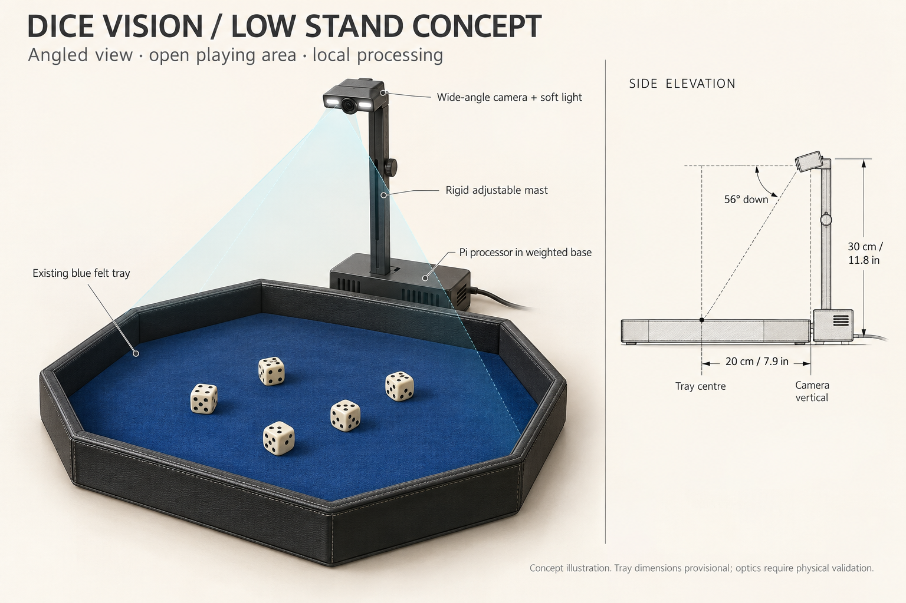

# Low angled camera for the Yahtzee tray

Research and concept design: 28 September 2026. Status: calculated concept, not a physically validated assembly or fabrication drawing.

**CAD update:** The user subsequently confirmed an 88.9 mm (3.5 inch) rim height. The [first CAD prototype](../../hardware/dice-vision-v1/README.md) supersedes this concept's mounting geometry: 300 mm lens height above the assumed floor, 67.38° downward aim, 20 mm head overhang and ±25 mm height adjustment. Earlier tray-wall assumptions below are retained as concept history, not final dimensions.

## Recommendation

Build a rigid stand on an unoccupied side of the tray, with its lens 300 mm above the inner playing floor and 200 mm horizontally from the tray centre. Aim down at 56 degrees below horizontal (34 degrees away from vertical). Provide 250–350 mm height adjustment and a locking tilt joint. Test the existing MX Brio in this geometry first. For an integrated device, use Raspberry Pi Camera Module 3 Wide, visible-light version, connected to a Raspberry Pi in the base.

This reduces the proposed lens height from approximately 610 mm to 300 mm, while leaving the playing area free of an overhead arm. Heights are measured from the playing floor to the lens, not to the top of the enclosure. All dimensions should be reconciled with the physical tray before CAD/fabrication.

The image is a product concept; its drawn proportions and dimension-arrow endpoints are illustrative. The dimensions in this document govern the intended geometry.

## Context and tray assumptions

Reviewed the current chat **Explore Yahtzee Dice Vision Options**, the camera development/testing notes, and the current recognition code. The lab includes a ten-roll, click-each-die confirmation workflow and advisory hand/seat detection. Its recognition baseline is for opaque, light D6 dice with dark pips.

The [supplied Amazon listing](https://www.amazon.com/dp/B0CSCLYX98) was inaccessible through the research tool. A [matching-ASIN reseller listing](https://www.ubuy.hk/en/product/J2ORPB9DK-reriver-dice-rolling-tray-blue-felt-lined-pu-leather-octagon-dice-tray-for-dungeon-crawler-games) reports 310 × 290 × 40 mm exterior dimensions. These are provisional exterior dimensions, not a measurement of the usable floor. Measure inner width/depth, rim height above floor, and actual die size. Calculations below assume 16 mm dice and use the full exterior rectangle as a conservative framing envelope.

## Why a different lens can help

Shorter focal length generally gives a wider view on the same sensor. Focal length alone is insufficient when comparing different sensor sizes: specify horizontal and vertical field of view, working distance, distortion, resolution and the actual capture mode.

Logitech specifies [MX Brio diagonal fields of view of 90, 78 and 65 degrees](https://www.logitech.com/en-sa/products/webcams/mx-brio-4k-webcam.html). At 16:9, a rectilinear 90-degree diagonal view corresponds to approximately 82 degrees horizontally and 52 degrees vertically. For a straight-down view, a 290 mm tray depth theoretically fits from about 296 mm above the floor before adding margins. Therefore, a two-foot requirement is not explained by the nominal widest lens setting alone. Digital zoom, narrower FOV, software crop and the extra table needed for hand tracking are possible contributors, not diagnosed causes.

First test the Brio at its widest 90-degree setting, minimum digital zoom and a verified uncropped stream. Inspect the actual lab view. A new camera is not necessary merely to establish whether this mounting angle works.

## Optical layout

| Parameter | Nominal design |
|---|---|
| Lens height above floor | 300 mm / 11.8 in |
| Horizontal lens-to-centre offset | 200 mm / 7.9 in |
| Lens setback beyond 290 mm exterior tray edge | 55 mm / 2.2 in |
| Optical axis to tray centre | 56.3 degrees below horizontal |
| Adjustable lens height | 250–350 mm / 9.8–13.8 in |
| Centre working distance | About 360 mm |
| Lens-to-near/far floor-edge distances | About 305–457 mm |
| Camera orientation | Landscape, wide axis between the two player sides |

Calculation: tilt = atan(300/200). For floor points at the near and far exterior edges, downward viewing angles are 79.6 and 41.0 degrees respectively. Relative to the optical axis, this requires 23.3 degrees toward the near edge and 15.3 toward the far edge. The conservative rectangular near corners require approximately ±29 degrees horizontally. This fits the Pi Wide nominal 102 × 67 degree field with room to spare and suggests the Brio can frame the tray too.

These are ideal pinhole estimates. Lens distortion, undistortion crop, focus breathing, mode-dependent sensor crop and mounting tolerances must be verified in captured images. Geometric coverage is not proof of pip-reading accuracy or unobstructed sight lines.

At 300 mm, the wide camera should also leave useful table context to the left/right. Start with about 100 mm of approach area on each player side, then check wrist visibility with real reaches. Put the stand between the player seats so it occupies neither player's approach side.

An 200–250 mm-high version is a later experiment. Simply lowering the head makes the far dice more oblique and wall visibility more problematic. At the nominal 300 mm geometry, far-edge floor viewing elevation is already only about 41 degrees even though the centre is viewed at 56 degrees. Do not promise rim-height single-camera reading. If a much lower enclosure becomes essential, compare two opposing cameras; that adds calibration, cost and disagreement handling and is not the first prototype.

## Camera choice

| Option | Findings | Decision |
|---|---|---|
| Existing Logitech MX Brio | USB webcam already in use; widest view may suffice at 300 mm | First geometry and recognition experiment |
| Raspberry Pi Camera Module 3 Wide, visible-light | 12 MP; 2.75 mm lens; 102-degree H / 67-degree V; motorised focus; documented close focus | Preferred integrated-device camera |
| Arducam B0446 family USB wide camera | Candidate USB alternative, but current variants differ substantially in field of view and focus specifications | Conditional alternative; verify exact SKU and close-focus capability before ordering |

The [official Pi camera specification](https://www.raspberrypi.com/documentation/accessories/camera.html) and [Module 3 product brief](https://pip-assets.raspberrypi.com/categories/786-raspberry-pi-camera-module-3/documents/RP-008151-DS-1-camera-module-3-product-brief.pdf) document the Wide optics and approximately 5 cm minimum focus. This covers our working distances but does not guarantee simultaneous sharpness everywhere. Focus near the middle of the dice-top distance range and inspect near/far pips before locking focus. Use the visible-light version rather than NoIR for normal colour imaging. The Wide module's published reference price is US$35; regional checkout prices/tax vary. [Official launch pricing](https://www.raspberrypi.com/news/new-autofocus-camera-modules/).

The [current Arducam product table](https://www.arducam.com/8mp-imx179-usb-camera-module-with-wide-angle-115h-m12-lens-for-windows-linux-android-and-mac-os.html) lists B0446-1 at 115-degree H, while the upgraded B044601 is 85-degree H. Both are listed with 300 cm-to-infinity default focus. Older selection material calls B0446 manual focus. Obtain confirmation of a lens adjustable and lockable around 0.3–0.5 m for the exact supplied SKU; the name 'wide angle' or an advertised resolution is insufficient. Do not assume the upgraded version preserves the old lens.

## Mechanical and electrical concept

- A rigid mast with height scale and locking tilt joint. Avoid flexible gooseneck drift; movement invalidates calibration.
- A small camera head with a short lens hood and replaceable mounting plate. Prototype enclosure target approximately 40–50 mm across, subject to actual board and hinge clearances.
- A ventilated Pi enclosure/weighted base, initial envelope approximately 120 × 90 × 40 mm. Final thermal design and stability need testing. A thin tongue under the tray and rubber feet resist accidental movement; a table clamp is a useful prototype alternative.
- Two diffused LED segments beside the camera, dimmable, directed at the tray. Add an opposite-side diffuse fill if the near rim casts problematic shadows. Use a suitable LED driver; do not drive lighting loads directly from GPIO.
- Concealed, strain-relieved camera ribbon through the mast. Pi 5 requires a Standard–Mini camera cable; confirm routing length and hinge bend radius. Power enters at the rear of the base.
- Pi 5 is a development processor candidate for local OpenCV/model work, with adequate power supply and cooling. Benchmark before selecting a smaller production processor. The CSI camera is not a plug-in USB webcam for the existing PC lab: Pi capture plus a stream or result bridge is required.
- Four small removable calibration markers on a rigid surround outside the rolling floor. Avoid altering the felt or putting markers where dice normally land.

The enclosure and mount should be removable without modifying the existing tray. Prefer a rigid relationship between tray and base so moving the assembly together does not change calibration.

## Required vision changes

The current `src/dice/camera-lab.js` scales incoming images to 960 pixels wide. `src/dice/camera/recognizer.js` thresholds bright contours and counts dark blobs in an inset axis-aligned bounding box. It does not isolate a die's top-face quadrilateral. A lower angled view exposes side pips, so this baseline is not evidence that the proposed optics fail if it misreads them.

1. Preserve the high-resolution source. Use a smaller stream for motion/hands and full-resolution regions or settled frames for dice. Increasing camera megapixels alone will not improve the current 960-pixel recognition path.
2. Calibrate distortion at the selected focus and capture mode; undistort before measuring geometry. OpenCV describes [camera calibration and undistortion](https://docs.opencv.org/4.x/dc/dbb/tutorial_py_calibration.html).
3. Calibrate the tray plane for masking, position and seat regions. A [planar homography](https://docs.opencv.org/4.x/d9/dab/tutorial_homography.html) does not recover occluded detail or transform a raised 3D die into a true overhead image.
4. Detect each top face, rectify that face where appropriate, then classify its pips. Compare a geometric baseline against a detector trained on labelled images from this mount if necessary. Top-face boundaries need additional annotations beyond the present centre-point/value labels.
5. Reject cocked/stacked/occluded dice and wait until hands leave and motion stops. Preserve manual confirmation and uncertainty. Touching flat dice may remain fully visible but still merge into one bright contour.
6. Recalibrate player approach zones for this camera orientation. Use table-space regions rather than assuming image top/bottom always correspond to the physical seats. Seat inference remains advisory.

Illustrative sampling calculation: at the far edge, a 16 mm die projects to only about 15 horizontal pixels in a 960-pixel-wide image with a 102-degree horizontal FOV. At a 4608-pixel-wide source it is approximately 70 pixels across before distortion/resampling losses. This is an idealized horizontal estimate, not the foreshortened top-face height. Start with a measured target of at least 40–60 pixels across the smaller top-face dimension in the image actually used for recognition; adapt resolution/crop/lens after inspecting the real frames.

## Validation sequence

1. Measure the tray and dice; mount Brio at 300 mm high / 200 mm horizontal offset, widest view, minimum zoom. Photograph the empty tray and dice at centre, each edge and each corner. Check complete top-face visibility, focus, glare and actual pixels per face separately from recognition output.
2. Collect the existing ten-roll review session at this angle, then another at the existing overhead setup. Include all six top values and near/far locations. Save physical camera pose and capture settings with each dataset.
3. Implement and evaluate top-face isolation and high-resolution sampling using these images. Separate optical failures from recognition failures.
4. Test the Pi Wide in the same fixture. Verify usable FOV in the chosen capture mode, undistortion margins, focus across the floor and LED reflections. Evaluate 250 mm height only after 300 mm works.
5. Use at least 100 fresh ordinary rolls plus deliberate touching, wall-adjacent, cocked and hand-entry cases after tuning. Report exact five-dice roll accuracy, uncertainty/retry rate, wrong-confident-read rate and latency. Record hand/seat accuracy separately. This is prototype evidence, not a production reliability certification.

Selection rule: use the lowest position that preserves readable top faces over the full playable floor and adequate approach visibility. Do not solve a single-view blind region by silently shrinking the playable area. If unavoidable blind regions remain, raise/reposition the camera or test a second view.

## Deliverables and boundaries

This work provides a researched camera recommendation, provisional mechanical layout, geometry estimates, software requirements and a perspective concept. It does not change the active camera lab, order hardware, establish measured recognition accuracy or provide manufacturing-ready CAD/STL files. Final enclosure design follows the physical optics test.
