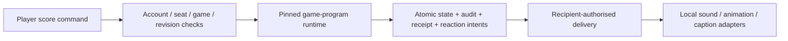

# SW075: Configurable game programs, player reactions and avatar stability

31 October 2026. Product owner: Dan. Author/integrator: Codex. Independent development-agent review: independent_engine_avatar_review, frozen da3f3eacdafaef0aa4ee2d23ab7e551e87e2d4c5. External/human release approval is not implied.

## Owner request and current state

Owner wants frame/category triggers, per-player conditions and configurable actions/audiences: Amber configures “when Dan records Full House, do X on Dan's phone or all other players' phones”. Actions include sounds, animations and commentary text. Game rules should be composed through a similar builder, supporting later variants. Restore profile-owned avatars across reload/change, stable Gemini integration, independent code review and safe dead-code cleanup. Owner authorizes branch integration/consolidation. Android/iOS phone tests precede promotion to master; Mac access/deployment setup is deferred until ready to test phones.

PRs #4–#7 are still open at task start; master is9179f73. Recovered features are combined on da3f3ea, not already merged to master. This task builds on that candidate without rewriting shared history. One canonical product/master remains the integration target; isolated developer/task branches are working views, not competing source masters.

Implemented in this slice: independently reproduced avatar fixes with regressions, obsolete production DOM isolation, strict bonus-Undo outbox target fix and a pure tested configurable reaction contract. The shared reaction editor, rule-builder UI, persistent reaction configuration, durable recipient delivery and new versioned gameplay runtime are DESIGNED BELOW, NOT yet implemented or activated. Do not claim the example can already be configured from a phone.

## Product model

“Frame” means a scorecard category, such as Full House, not a render frame or necessarily the thirteenth turn. Category keys remain stable when labels change. Distinguish author, score actor, media subject and recipients:

- Author: Amber's authenticated account; only its own authored rules are editable by that member.
- Actor: Dan's authenticated table seat/account, not the text “Dan”. Shared-phone/solo games use explicit game-scoped seat IDs; names remain display labels.
- Subject: whose selected avatar/reaction is shown; default the scorer. Recipient choice does not silently change the media subject.
- Audience: scorer, everyone except scorer, all table members, or selected members. “Others” excludes Dan in this example, even when Amber authored it. Multiple devices for the same account honour a documented per-device mute/delivery policy rather than claiming exactly-once audible playback.

### Builder experience

Table menu → Fun reactions → Add reaction:

1. When: “Score recorded” → category “Full House” → player “Dan”; optionally score “25” rather than scratch0.
2. Do: select registered sound/animation and/or type a plain-text caption. Preview locally without saving a score, posting a game command or calling a paid provider.
3. Show/play on: “Dan”, “Everyone except Dan”, “Everyone”, or selected table players. Preview names are labels over stable account identities.
4. Save: versioned definition with author and table scope. It applies to later accepted score revisions; previously accepted events do not acquire new reactions.

Controls include enabled state, priority/queue policy, clear edit/save status, conflict/reload handling, and delete/disable semantics. Host can disable table reactions, members can manage their own authored definitions, and each recipient can mute sound/reduce motion. Text remains textContent, never HTML/code. No arbitrary script, remote URL, provider key or hidden score command is an action.

The first production actions are curated sound assets, existing avatar-reaction assets and prewritten text. Generated spoken commentary, uploads and provider-backed media are separately gated adapters with explicit budgets/latency tests; writing a text reaction does not automatically start Gemini/ElevenLabs. Existing video reads only access the authorised confirmed avatar and room audience.

### Game-rule builder

Use the same “when/condition/consequence” vocabulary, but a separate authority/runtime:

- Game definition: board/category schema, points/score legality, dice/input requirements, turn/roll policy, bonuses, completion and correction/Undo policy.
- Approved consequence primitives: award category points/bonus, advance/retain turn, open bounded bonus attempt, finish a game, update eligible achievement facts. These run deterministically inside the authoritative engine, never inside media playback.
- Rule templates: Standard, Competition and Accumulative become named, versioned programs with worked examples. Custom variants clone a template into a draft, modify supported values/policies, validate and publish a new immutable version. Host chooses a published version before starting; the lobby exposes its rule explanation to all players.
- A program may express “Full House awards25” or an explicit house rule “Full House opens another turn” through approved primitives. Unsupported combinations/contradictory awards/cyclic automatic transitions are rejected, not executed as arbitrary JavaScript. Define intentional stacking vs exclusive policy; no implicit double awards.
- New gameplay semantics require new program/version/hash/interpreter identities. Existing games retain the selected contract; a reaction edit cannot covertly change points/turns. No mid-game rule replacement, retroactive rule reinterpretation or silent data migration.

The supported initial family is turn-based dice scorecard games. Additional categories/boards/policies use declared extension interfaces; this does not promise arbitrary genres without new reviewed primitives. Preserve manual input provenance and hardware proposal/seat authority boundaries.

## Architecture and contracts

### Game program registry

Each published game uses programId, programVersion, contentHash, programSchemaVersion, runtimeVersion and state/event schema versions. Use canonical content hashing and immutable published records; registry contains explicit policy implementations. New code cannot reinterpret an old profile merely because its data still says version2. Unknown/ambiguous historical Competition v2 contracts require an explicit compatibility decision; the recovery does not silently choose one.

`transition(state, command, context) -> {nextState, events}` remains pure/synchronous, with supplied IDs/time/randomness. Local orchestration persists before publishing accepted events. Hosted orchestration validates authority and commits state/history/receipts and intent rows atomically. Fingerprints bind command retries to actor/action; provider/media failures must not undo or duplicate scoring. Keep the recovered four-second shared-announcement policy until its replacement is explicitly selected and tested; it is not dead code to delete automatically.

### Reaction definitions

Definition identity: setId/version, scopeId, effectiveAfterRevision, and immutable rule id/version. Every rule stores authorId, enabled, when(category, actorId, optional value), audience and actions. Local identity namespace is explicit. Bounds: max32rules/set, max3actions/rule, short240-character text, registered assets only. Future extensions require schema versions and tests.

src/experience/reactions.js implements validation and deterministic recipient-plan evaluation only. It is deliberately not wired to the current hard-coded presentation, room RPC or UI. Tests exercise the Dan/Amber/others case, explicit audiences, category/value mismatch, future-only edits, stable delivery keys, local-seat scope and rejection of scoring/provider actions. The module does not authenticate callers; future server adapters must derive author and roster from authenticated membership rather than trusting the JSON.

Only accepted ScoreRecorded facts trigger the initial contract. Corrections, Undo, hydration and score proposals are separate event types and quiet by default. A future canonical mapper must retain every accepted fact in command order, not only the final event from a snapshot diff. Event carries eventId, commandId, gameId/table scope, accepted room revision, rule-program identity, actorId/seat, category/value, provenance and acceptedAt. Fact/audience projections must honour hidden totals and private media boundaries.

Initial pure plans have live-only15second expiry and stable IDs over table/set/rule version/game/event/recipient. The actual presentation duration and user pacing policy are separate and not changed here. Persist accepted version/snapshot with durable intents, so later config edits cannot change previously accepted messages. Deliver through authenticated polling/realtime; no push setup or arbitrary network broadcast is needed for foreground play. Deduplicate per recipient/device; acknowledge delivery separately from acceptance. Reconnect must not replay expired jokes. Disabling a rule stops future creation; host stop/mute cancels active/queued effects explicitly. Corrections/Undo invalidate dependent pending effects and achievements without deleting audit.

### Persistence and permissions (next implementation)

Use separate versioned game-definition and table-reaction-set storage. Reuse current Auth UUID/RLS, exact table membership, CAS revisions and transaction receipts. Save-reaction mutation stamps author from auth, validates actor/recipient roster and allowlisted assets, preserves another author's rules, and increments table/config revision. Host can disable a definition/table policy; ordinary members cannot edit other authors' content or gameplay programs in an active game. Local mode uses the same compiled schema with local-seat identities and durable local persistence.

Drafts/templates can be profile-owned and reusable; attaching one to a table revalidates all actor/audience identities. A template referencing Dan outside a shared room grants no access to him or his media. Existing room data does not implicitly authorise profiles, historical aliases or private original-photo access.

## Independent review and fixes

Full original findings and recheck are recorded separately in [review report](SW-075-independent-review.md). Review established five P2 avatar failures: stale-revision rollback; wrong account preset selected; uncertain generation duplicate IDs/missing retry; signed-image failure hiding durable metadata; cleanup starving profile/status reads.

Implemented boundaries:

- Own/peer avatar acceptance respects saved revisions; one lookup serves Home/game views. Equal-revision refreshed signed URLs remain usable.
- Preset selection follows account metadata, and confirmation without a deliberate new selection preserves the fetched server choice instead of writing the device default.
- Pending generation identity survives uncertainty. Check saved draft reads the same ID. A new paid job is blocked until reconciliation or explicit local Forget; Forget states it does not cancel/refund generation. No automatic provider retries.
- Profile metadata survives signed-image delivery failures and marks imageStatus unavailable. UI explains “saved portrait · reconnecting”, retaining a profile-owned choice instead of implying deletion.
- Profile/status/peer/animation metadata reads skip unrelated cleanup; mutation cleanup has a bounded budget and never acknowledges an unfinished deletion. Storage/RPC requests have finite deadlines; signing is bounded separately.
- Valid owned bonus/final-chain Undo targets can reach the commentary invalidation outbox; ordinary corrections still cannot target bonus events.

Official Google documentation confirms the existing gemini-nano-banana-2.1 model and /v1beta/interactions image format. Do not change model names to fix UI/network recovery. Keep server-held key, bounded requests, stable job IDs, budget reservation and explicit confirmation. Mocked tests do not establish live service availability or personal-photo quality. No paid generation was run; future live qualification needs existing server configuration, an explicit bounded trial and owner observation.

## Cleanup

Removed obsolete two-player DOM from production index.html. Its exact shell is retained at tests/fixtures/legacy-shell.html, preserving existing legacy integration assertions rather than deleting them to manufacture green tests. Bootstrap now describes the actual product path.

Legacy main/db/rules/moments/mascot/custom-trigger modules remain test-referenced; shared scoring/categories/CSS are production dependencies. They are inventoried for explicit isolation, not indiscriminately deleted by age/name. Preserve active edge source and generated bundles. No npm mass-upgrade, system changes, live-data cleanup or private-media deletion.

## Delivery, acceptance and branches

Consolidate #4 phone-install record, #5 design, #6 guards, #7 recovered source and this review/fix into one integration candidate through normal branch merges; preserve history and existing branches. Superseded PRs can close after the new candidate is published. Master promotion remains after Android/iOS phone acceptance. Both accounts start new work from the selected integration commit in separate worktrees; master becomes the base after approved promotion. No simultaneous writes in one folder.

| Gate | Required evidence | Current state |
|---|---|---|
| Review | Frozen original source, named independent agent, reproductions, separate fix recheck | Original review and final independent source recheck complete;55focused tests passed |
| Avatar stability | Permanent race/reload/draft/cleanup regressions plus existing privacy/provider coverage | Independent recheck55tests plus clean full gate1,318passed/13optional skips; all configured builds passed |
| Reaction foundation | Author/actor/audience example and rejected unsafe/foreign/retroactive actions | Pure contract implemented;9tests pass; editor/delivery not implemented |
| Game builder | Approved programs, worked examples, immutable dispatch and complete-game invariants | Design; not implemented; rule decisions remain open |
| Cleanup | Actual production reachability evidence; legacy coverage retained | Dead shell isolated; broad legacy deletion deferred |
| Android | Configured gate/native tests, then actual account/avatar/reaction/layout journeys | Clean source full gate and Android19native tests/compile passed; actual phone tests deferred |
| iOS | Mac signing/compile, same packaged source and paired phone journeys | Blocked until owner arranges Mac access at deployment stage |
| Master | Owner accepts identified Android/iOS builds; no required review defects open | Not eligible for promotion yet |

No new app installation, public backend/schema/scheduler deployment, provider call or live score mutation is authorised by branch consolidation. Preserve accounts, avatar choices, stored originals and active tournaments. Record actual verification results below; do not prefill physical acceptance.

Sources: https://ai.google.dev/gemini-api/docs/image-generation and https://ai.google.dev/api/interactions-api (read31October2026).

### Integration candidate

Working integration branch is codex/yahtzee-integration, in the isolated SW075 worktree. It includes all design/safeguard/recovery ancestry and a normal merge of the remaining phone-record branch; conflicts were documentation-only and both dated records were preserved. Master stays9179f73. The candidate PR will supersede the stacked review chain without deleting its branches/history.

### Final source verification

Clean integration commit4befc840da9f5365a7f8db562a23fa6e9e7ef6e8 passed Node24.15.0 full configured gate:1,318tests/13optional camera skips/all configured builds, clean stable source. Source digest05d71f79eec181e880b039243a3469c049f22d6efff9e923d78890ab498a3e6e; evidence artifacts/engineering/2026-10-31T18-13-35-715Z-0315ec48/report.json. An initial run passed all tests/builds but failed source stability because the generated game-room bundle was stale; output was committed and clean gate repeated. No checks were weakened.

Android JDK21 testDebugUnitTest/assembleDebug passed19native tests. Prepared manual files matched APK assets and embedded clean4befc84 identity; this is an offline compile check, not a configured rollout package. Android evidence lives under ignored artifacts/sw075 outside this source checkout. iOS manual web build passed; native Xcode/signing, real avatar/video/reload/account tests, live Gemini trial and paired phone gameplay remain unperformed. No live provider/data/backend/device action occurred.

### Published review and handoff

Draft PR #8 is the single consolidated review targeting master. Superseded PRs #4–#7 were closed after publication; their branches/history were retained. docs/next-chat-current.md routes both accounts to the candidate and exact verification limits. Shared coordination checkout may follow codex/yahtzee-integration; master branch remains unchanged pending phone acceptance.
